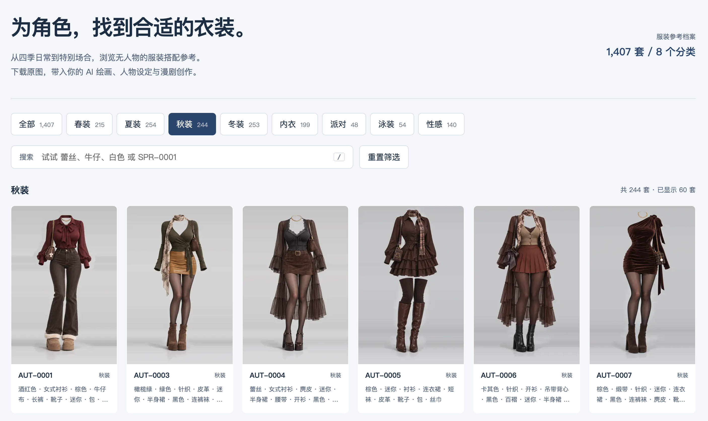
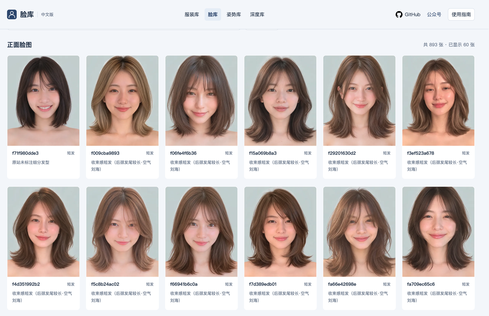
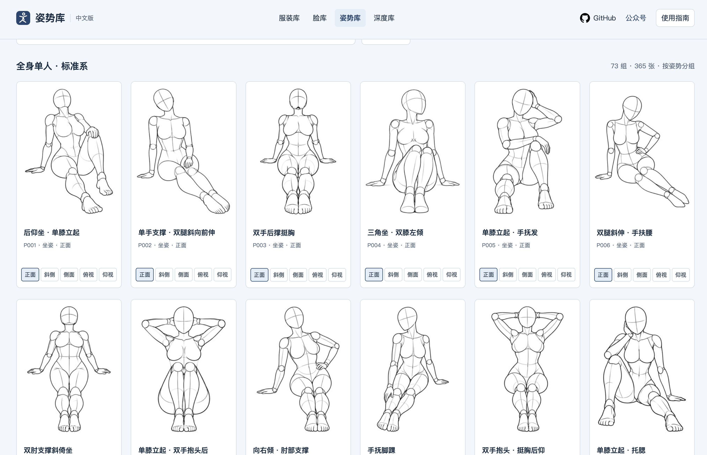
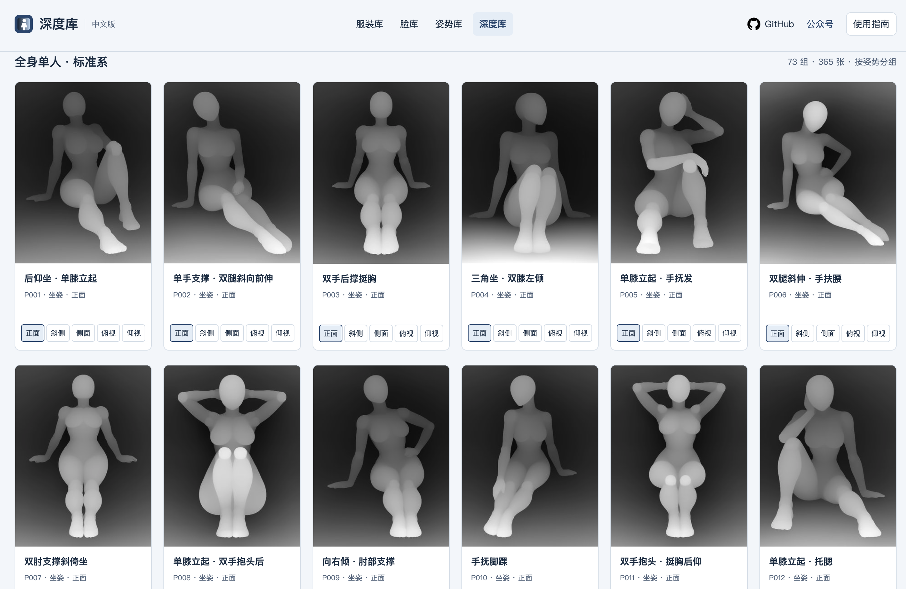
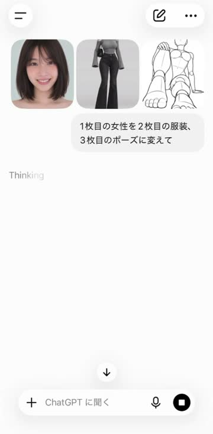
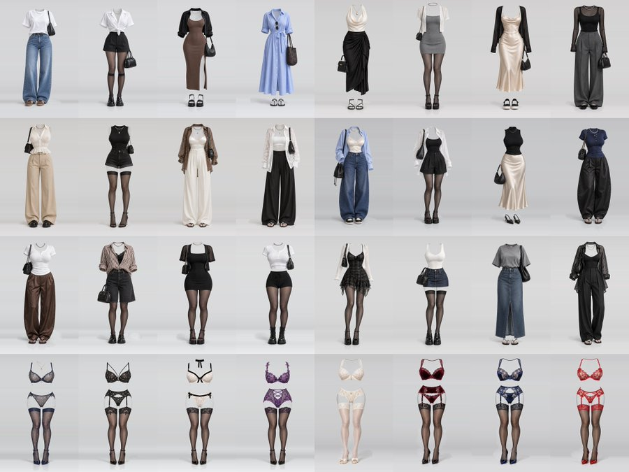
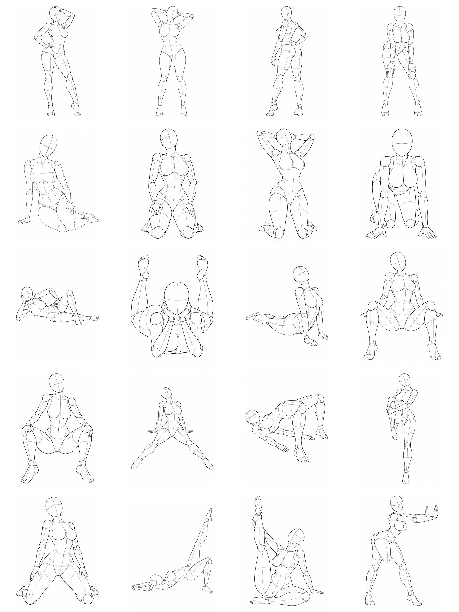

# AI 参考图库中文版｜服装库 · 脸型库 · 姿势库 · 深度库

面向 AI 绘画、角色设定与漫剧创作的四合一中文参考图库：**服装库选衣装，脸型库选人物与发型，姿势库看动作结构，深度库看空间前后关系**。支持中文检索、多视角浏览、PNG 原图下载。原始与中文索引、零依赖静态页面、Python 维护脚本及 GitHub Pages 自动部署放在同一开源仓库维护。

**在线浏览地址：[服装库](https://deeyu.github.io/ai-costume-gallery-zh/) · [脸型库](https://deeyu.github.io/ai-costume-gallery-zh/portrait/) · [姿势库](https://deeyu.github.io/ai-costume-gallery-zh/pose/) · [深度库](https://deeyu.github.io/ai-costume-gallery-zh/depth/)** · [版权与致谢](#版权与致谢)

四个页面顶部均显示内容提示。导航始终提供四个图库入口，并在滚动时固定显示；当前图库有选中标记，每个页面底部均列出四库的来源地址与作者。“中文版”旁的“日文源版”在新标签页打开对应作者原站。

本项目是独立的中文整理与静态站点学习实践，不代表原作者的官方版本或背书。

数据来源：[衣装集](https://ai-costume-gallery.pages.dev/) · 原作者X：[ギア](https://x.com/giaaibusi) · 中文版维护：[Deeyu](https://github.com/Deeyu)。

脸型库来源：[AIモデル顔データベース](https://ai-portrait-gallery.pages.dev/) · 原作者：[あぎ（@agi_aibusi）](https://x.com/agi_aibusi) · [原作者推文](https://x.com/agi_aibusi/status/2113187345814204557)。

姿势库来源：[AI 姿势原始图库](https://ai-pose-gallery.pages.dev/) · 原作者：[ギア（@giaaibusi）](https://x.com/giaaibusi) · 中文词条：[Anhao 中文姿势图库](https://github.com/anhao/ai-pose-gallery-zh)。

深度库来源：[POSE-DB-02 深度图库](https://ai-pose-depth-gallery.pages.dev/) · 原作者：[ギア（@giaaibusi）](https://x.com/giaaibusi) · 中文词条与姿势库同源。

## 四个图库如何选择

| 图库与介绍 | 用途 | 实际收录 | 在线浏览 |
| --- | --- | --- | --- |
| [服装库](#costume-library) | 无人物衣装搭配、角色服装设计 | 1,407 套，8 个分类，每套三个图片版本 | [打开服装库](https://deeyu.github.io/ai-costume-gallery-zh/) |
| [脸型库](#portrait-library) | AI 虚构人物的五官、发型和造型参考 | 1,499 张：893 张正面脸图、606 张造型参考 | [打开脸型库](https://deeyu.github.io/ai-costume-gallery-zh/portrait/) |
| [姿势库](#pose-library) | 人体动作教学、线稿结构与双人构图 | 288 组、1,439 张线稿，4 体系、26 分类 | [打开姿势库](https://deeyu.github.io/ai-costume-gallery-zh/pose/) |
| [深度库](#depth-library) | 姿态、遮挡和空间前后关系参考 | 288 组、1,439 张深度图，4 体系、26 分类 | [打开深度库](https://deeyu.github.io/ai-costume-gallery-zh/depth/) |

服装图在仓库内保存缩略图、预览图及 PNG；脸型库、姿势库和深度库只保存完整双语索引，图片按需由各自原站提供。数量按各库独立记录统计，不将不同文件版本或视角重复计为不同服装或人物。

脸型库原站标注 CC0，同时请求不要重新分发图片，因此本仓库不打包脸型库图片。脸型库浏览与下载依赖原站；1,499 是图像记录数，不代表互不重复的人物数量。

姿势库完整收录参考仓库的 **1,439 条图片记录**，用于**人体动作教学、绘画练习、身体结构与构图参考**。素材为无面部、无生殖器细节的人体模型线稿；保留来源体系、分类、姿势名称及编号，不依据名称删减记录。原站禁止图片批量下载及再分发，因此本仓库保存完整索引，图片逐张由原站提供，浏览与下载依赖原站。

## 服装库演示视频

https://github.com/user-attachments/assets/c508ccfd-4144-4907-8ca1-5631c587e0f7

## 界面预览



<a id="costume-library"></a>

## 1. 服装库：衣装搭配与角色造型参考

服装库（Costume Gallery）提供 **1,407 套不含人物的服装参考**，适合角色服装设计、AI 绘画和漫剧造型。先按季节或场合选衣装，再通过双语关键词细化材质、颜色和搭配，下载 PNG 后放入创作工具的服装或图片参考功能。人物脸型、体型与背景需另行指定。

**[在线使用服装库](https://deeyu.github.io/ai-costume-gallery-zh/)** · [原始衣装集](https://ai-costume-gallery.pages.dev/) · [中文索引](data/costume-zh.json) · [纯文本介绍](catalog.md)

### 收录与图片版本

| 分类 |  套数 |
| ---- | ----: |
| 春装 |   215 |
| 夏装 |   254 |
| 秋装 |   244 |
| 冬装 |   253 |
| 内衣 |   199 |
| 派对 |    48 |
| 泳装 |    54 |
| 性感 |   140 |
| 合计 | 1,407 |

数据快照日期：2026-10-29。86 个英文关键词及 8 个分类全部附中文译文。标签来源于原站，可能不完整，不能当作完整生成提示词。图片为不含人物的服装参考，纵横比 2:3。

**完整本地镜像**：1,407 套服装，每套保存三个图片版本，共 4,221 个图片文件，约 1.42 GiB。它们对应相同的 1,407 套服装。首次克隆体积较大；清单 `data/local-assets.json` 记录已校验的本地文件。

| 目录        | 版本        | 文件数 |           体积 | 用途           |
| ----------- | ----------- | -----: | -------------: | -------------- |
| `thumbs/` | WebP 缩略图 |  1,407 |     约 9.8 MiB | 列表浏览       |
| `img/`    | WebP 预览图 |  1,407 |   约 113.5 MiB | 大图浏览       |
| `png/`    | PNG 原图    |  1,407 | 约 1,331.1 MiB | 下载与创作参考 |

本地完整版直接读取以上全部素材。GitHub Pages 版本托管缩略图和预览图，下载 PNG 时从本 GitHub 仓库读取原图；两种方式均不依赖原站提供图片。

### 服装库功能

- 中文分类，支持中文、英文、ID 搜索；多个词以空格分隔，按“同时包含”匹配。
- 响应式网格、缩略图异步解码与懒加载；接近列表底部自动追加，每批 60 套。
- 大图浏览、PNG 原图下载、复制 ID；左右方向键切换、Esc 关闭、`/` 聚焦搜索。
- 无框架、无运行时依赖、无统计或遥测。
- 原始与中文 JSON、94 条对照词典、下载重试、素材校验、CI。

<a id="portrait-library"></a>

## 2. 脸型库：AI 虚构人物与发型参考

脸型库（Portrait Gallery）提供 **1,499 张 AI 虚构人物参考图**，用于挑选五官、脸型、发型和角色整体造型。正面脸图便于观察面部结构，造型参考展示发型质感与整体氛围。原站标注这些是虚构人物，收录数是图片记录数，不等于独立人物数量，也不提供人脸识别。

**[在线使用脸型库](https://deeyu.github.io/ai-costume-gallery-zh/portrait/)** · [原始脸型库](https://ai-portrait-gallery.pages.dev/) · [中文索引](portrait/data/portrait-zh.json) · [纯文本介绍](portrait/catalog.md)

### 脸型库界面预览

以下为正面脸图列表截图，展示人物卡片、发长与细分发型信息。



### 脸型库功能与收录

- “正面脸图 / 造型参考”两种模式，各自显示数量与发长筛选结果。
- 4 类发长、50 种细分发型全部汉化，保留原始日文名称；未标注的细分发型保持为空，不推测人物特征。
- 支持中文、日文、模式英文名及图片 ID 搜索，多个词同时匹配；滚动到底部自动追加，每批 60 张。
- 保留原站下载排行的本地快照，明确显示快照日期，不代表本站访问或下载统计。
- 灯箱导航、PNG 下载、复制 ID、键盘操作；与服装库共用 GitHub 及公众号入口。
- 页面与脚本独立编写，不包含原站的点击上报、实时排行请求或 LINE 引流。

| 发长 | 正面脸图 | 造型参考 | 合计 |
| --- | ---: | ---: | ---: |
| 短发 | 433 | 294 | 727 |
| 中发 | 229 | 147 | 376 |
| 中长发 | 154 | 106 | 260 |
| 长发 | 77 | 59 | 136 |
| 合计 | 893 | 606 | 1,499 |

脸型库快照日期：2026-10-30。`portrait/data/` 中保留原始 JSON、中文 JSON、分类计数、原始/中文排行快照及 56 条分类与发型对照。中文记录包含图片 ID、模式、发长、细分发型、原始日文、原站图片 URL、原图尺寸与大小、检索文本。

从仓库根目录启动 `python3 -m http.server 8000 --bind 127.0.0.1`，打开 <http://127.0.0.1:8000/portrait/>。

更新与校验脸型库索引：

```bash
python3 scripts/portrait.py sync
python3 scripts/portrait.py verify
python3 scripts/portrait.py check-images --limit 8
```

`sync` 只读取原站公开的元数据和排行快照，不下载或镜像图片，也不执行原站 JavaScript。也可使用已保存的文件：`python3 scripts/portrait.py sync --images-js /path/to/images.js --ranking-js /path/to/ranking.js`。出现新增分类或发型时会先报错，补齐词典后再更新，避免静默漏译。`check-images` 仅用 HEAD 请求抽查不同模式和发长的图片地址。

<a id="pose-library"></a>

## 3. 姿势库：人体动作教学与绘画参考

姿势库（Pose Gallery）提供 **288 组、1,439 张人体模型线稿**，用于观察动作、身体轮廓、关节关系和双人构图。可按体系、动作或视角筛选，选择线稿作为绘画练习和 AI 创作的动作参考。保留来源分类及编号，包含成人向姿势与相关术语，仅限成年人使用。

**[在线使用姿势库](https://deeyu.github.io/ai-costume-gallery-zh/pose/)** · [原始姿势库](https://ai-pose-gallery.pages.dev/) · [中文索引](pose/data/pose-zh.json) · [纯文本介绍](pose/catalog.md)

### 姿势库界面预览

以下为标准系姿势列表截图，展示按姿势分组的人体模型线稿与卡片内视角切换。



### 姿势库功能与收录

- 完整 288 组、1,439 张图，涵盖原站 4 个体系、26 个分类；使用人体模型线稿观察动作、重心、身体结构和双人构图。
- 正面、斜侧、侧面、俯视、仰视五种视角。287 组各有 5 张；`full_sexy_P018` 在上游仅有 4 张，缺少仰视图，页面按实际视角显示，不补造缺失图片。
- 分组浏览与单图浏览，按体系、动作分类和视角筛选；支持中文、日文、ID 及多词搜索。人物、动作和视角采用可取消的直接选项，动作支持展开更多；筛选条件保存在 URL，可复制链接复现。
- “全身·性感”和“双人”标签带红色“成人向”标识；每次进入先弹窗提醒，确认后再切换，取消或关闭保留当前筛选。直达这两个分类的链接也会先提醒。
- 卡片和大图均提供视角缩略图；大图中左右键切换视角、上下键切换姿势，切换姿势时保留当前角度；手机可左右滑动大图。
- PNG 原图下载、复制图片与 ID、公众号二维码，与服装库和脸型库相互导航；滚动追加每批 24 组／张，保留已有卡片视角。

| 体系（沿用来源名称） | 姿势组数 | 图片记录数 |
| --- | ---: | ---: |
| 全身单人・标准系 | 73 | 365 |
| 全身单人・性感系 | 80 | 399 |
| 上半身单人 | 80 | 400 |
| 双人缠绵 | 55 | 275 |
| 合计 | 288 | 1,439 |

快照日期：2026-10-30。中文词条基于 [Anhao/ai-pose-gallery-zh 的固定提交](https://github.com/anhao/ai-pose-gallery-zh/tree/072a3690af6e7e0011abbe0fa1ccc08939fbb47d)，完整保留其 1,439 条原始日文及中文记录、对照词典与来源提交，界面与脚本独立编写。使用体系前缀和姿势编号共同分组，避免不同体系的同编号混在一起。教学与绘画参考为本项目的用途说明，不代表原作者的背书或额外素材授权。

从仓库根目录启动 HTTP 服务，访问 <http://127.0.0.1:8000/pose/>。更新与校验：

```bash
python3 scripts/pose.py sync
python3 scripts/pose.py verify
python3 scripts/pose.py check-images
```

`sync` 读取参考仓库同一固定提交中的完整日文、中文索引和许可，不按分类删减，不下载图片。`--commit` 可指定上游提交；也可使用 `--original-json`、`--chinese-json`、`--license` 配合 `--commit` 读取本地快照。更新会检查日文与中文 ID 集合一致、记录数与上游一致、路径、同组名称和视角；当前已知的缺失仰视图记录在 `meta.json` 的 `missing_views` 中，其他视角缺失会报错。`check-images` 用 HEAD 请求抽查四个体系五个视角的缩略图及 PNG，共 40 个地址。

<a id="depth-library"></a>

## 4. 深度库：姿态与空间前后关系参考

深度库（Depth Gallery）提供 **288 组、1,439 张人体模型深度图**，通过灰度表达姿态、遮挡与空间前后关系：**白色越近，黑色越远**。与姿势库使用对应编号和视角，但两库使用不同图像形式与原站地址；深度图不是线稿或法线图。包含成人向分类，仅限成年人艺术与动作参考。

**[在线使用深度库](https://deeyu.github.io/ai-costume-gallery-zh/depth/)** · [原始深度库](https://ai-pose-depth-gallery.pages.dev/) · [中文索引](depth/data/depth-zh.json) · [纯文本介绍](depth/catalog.md)

### 深度库界面预览

以下为标准系深度图列表截图，展示灰度深度参考与多视角切换；本库约定白色越近、黑色越远。



### 深度库功能与用法

- 中文、日文、ID 多词检索，人物、动作与视角直接筛选，可再次点击取消；动作支持展开，筛选链接可分享。
- “全身·性感”和“双人”同样显示红色“成人向”标识，并在切换前弹窗确认。
- 分组／单图浏览，卡片与大图的视角缩略图、手机滑动切换、PNG 图片复制及原尺寸下载；滚动追加每批 24 组／张。
- 选择姿势和视角后，下载 PNG，导入所用 AI 工具的深度参照功能；具体参数以工具说明为准。
- 深度图不包含脸型、服装和背景，需要通过其他参考图或提示词补充；手指及肢体重叠边界需检查生成结果。

原始站点：[POSE-DB-02 深度图库](https://ai-pose-depth-gallery.pages.dev/)。本地页面：`depth/`。启动 HTTP 服务后访问 <http://127.0.0.1:8000/depth/>。

快照日期：2026-10-30，完整 288 组、1,439 张深度图，涵盖 4 个体系、26 个分类。白色越近、黑色越远，可将原尺寸 PNG 导入 AI 工具的深度参照功能。支持中文、日文、ID 多词搜索、分类与视角筛选、分组与单图浏览、大图、方向键切换和单张下载。同姿势 `full_sexy_P018` 在原站缺少仰视图，仅显示实际四视角。

`depth/data/depth.json` 保存原始日文索引，`upstream-zh.json` 保留中文词条快照，`depth-zh.json` 包含中文检索字段及深度原站图片 URL，`meta.json` 记录计数、缺失视角、原页面 SHA-256 与中文来源提交。中文词条与现有姿势库同源，逐条核对日文元数据后复用，保留 [Anhao 来源许可](depth/UPSTREAM_LICENSE)。两库使用独立图片地址，深度库不会用线稿替代深度图。共享姿势库的筛选函数及布局样式，不增加运行时依赖。

```bash
python3 scripts/depth.py sync                 # 仅更新公开元数据，不下载图片
python3 scripts/depth.py sync --html /path/to/saved.html
python3 scripts/depth.py verify
```

原站禁止图片批量下载和再分发，因此仅保存完整索引，图片按需由原站提供。界面独立编写，不包含原站统计或引流脚本。构建与 CI 已包含深度库，执行现有 GitHub Pages 发布流程时会一起发布。

### 滚动加载与图片预加载

四库在接近列表底部时自动追加下一批卡片，筛选或切换模式会重新从首批开始；姿势库与深度库追加时保留已浏览卡片的视角。首批缩略图优先加载并异步解码，其余图片懒加载；接近下一批时最多提前请求 12 张缩略图，同时最多 4 个预加载请求。省流量模式或 2G 网络跳过提前请求。不会预取整库或批量下载 PNG 原图，实际显示速度取决于图片来源站与网络。

## 联合使用案例：从角色定妆到漫剧分镜

参考[半格（@ai_bange）的联合使用案例](https://x.com/ai_bange/status/2115651909948477678)，先分别用姿势图说明动作、服装图说明穿搭。下面进一步加入脸型库与深度库，适用于中文 AI 绘画、AIGC 角色设定、漫剧和短剧分镜准备；扩展步骤与提示词由本站整理，属于操作示例，未提供模型实测效果。

### 联合使用演示与参考图片

[打开视频与图文案例](https://deeyu.github.io/ai-costume-gallery-zh/examples/) · [下载原始 MP4](examples/joint-reference-demo.mp4)

<a href="https://deeyu.github.io/ai-costume-gallery-zh/examples/"></a>

视频约 5 秒，展示脸部、服装和姿势参考的组合输入。点击封面进入播放器。下方两张合集展示可选素材，实际使用时各挑选一套服装与一个姿势。

| 服装参考合集 | 姿势参考合集 |
| --- | --- |
|  |  |

视频与两张合集由用户提供，关联思路参考[半格的原帖](https://x.com/ai_bange/status/2115651909948477678)；原始素材作者与使用条件见[版权与致谢](THIRD_PARTY_NOTICES.md)。

| 案例 | 参考图组合 | 操作要点 |
| --- | --- | --- |
| 角色动作与穿搭 | 姿势线稿＋服装图 | 服装库搜索 `SPR-0001`；姿势库选择标准系 `full_single_P015_front`。分别说明衣装和身体动作的参考职责。 |
| 角色定妆 | 脸图＋服装图 | 如选脸图 `f71f980dde3`，配合已选衣装；确认五官、发型、服装后，保存定妆图和素材 ID，供后续镜头复用。 |
| 漫剧／短剧分镜 | 定妆图＋姿势图，按需加入深度图 | 深度库搜索同体系、同编号、同视角的 ID；在支持深度参照的工具中导入 PNG，明确遮挡与远近，并补充场景、景别和光线。 |

中文提示词示例（姿势＋服装）：

```text
为成年原创角色制作春日全身动作参考图，竖幅，简洁浅灰背景。
图 1 负责服装：参考款式、配色、材质与搭配层次。
图 2 负责动作：参考身体重心、手臂位置、腿部姿态和观察角度。
人物比例自然，完整展示衣装和鞋子，衣料随动作自然垂落。
```

具体输入方式以 AI 工具支持的功能为准；普通参考图不等于深度控制输入，人体线稿也不等于 OpenPose 骨架。多镜头的人物一致性需逐张检查。[完整联合使用指南](guide.md)包含三个案例的步骤、中文提示词、核对方法和四库来源。

## 目录

```text
index.html                 中文静态画廊
assets/                    CSS、JavaScript、图标
data/costume.json          原始记录（保持原始日文字段）
data/costume-zh.json       中文分类、关键词及双语检索字段
data/meta-zh.json          分类计数
data/translations.csv      分类及关键词对照
thumbs/                    WebP 缩略图
img/                       WebP 预览图
png/                       PNG 原图
scripts/                   提取、翻译、下载、校验、构建
tests/                     数据与提取安全校验
portrait/                  脸型库中文版（独立子页面、界面与数据）
portrait/data/portrait.json 原始脸型库元数据
portrait/data/portrait-zh.json 中文发长、发型及检索字段
portrait/data/ranking-zh.json 原站下载排行快照
scripts/portrait.py        脸型库元数据提取、翻译及校验
pose/                      姿势库中文版（分组、单图与多视角浏览）
pose/data/pose.json         完整 1,439 条原始日文记录
pose/data/upstream-zh.json  Anhao 完整中文词条快照（1,439 条）
pose/data/pose-zh.json      中文检索、分组与原站图片 URL
pose/UPSTREAM_LICENSE      Anhao 参考项目的完整许可与范围说明
scripts/pose.py            姿势索引同步、来源记录与校验
depth/                     深度图中文版（页面、完整索引与来源许可）
scripts/depth.py           深度原站索引提取、中文词条核对及校验
scripts/seo.py             四库搜索元数据、静态介绍与摘要生成/校验
examples/                  联合使用案例播放器、视频与两张参考合集
sitemap.xml                四个图库与联合案例的正式地址
llms.txt                   AI 检索摘要与来源入口
catalog.md                 服装库纯文本介绍（各子库也有独立文件）
guide.md                   中文四库联合使用指南与提示词案例
docs/seo.md                SEO/GEO 维护方法、中文检索场景与托管边界
.github/workflows/         数据校验与 GitHub Pages 自动部署
LICENSE                    本项目独立程序代码的 MIT 许可
THIRD_PARTY_NOTICES.md      第三方素材、许可范围与致谢
```

## 服装库数据结构

`data/costume.json` 保留原始日文字段；`data/costume-zh.json` 是前端读取的中文记录。

| 字段           | 示例或含义                           |
| -------------- | ------------------------------------ |
| `id`         | `SPR-0001`，沿用原站唯一编号       |
| `分类`       | 春装等 8 个中文分类                  |
| `关键词`     | 中文关键词数组                       |
| `英文关键词` | 原始英文关键词，便于对照与搜索       |
| `缩略图`     | `thumbs/SPR-0001.webp`             |
| `预览图`     | `img/SPR-0001.webp`                |
| `原图`       | `png/SPR-0001.png`                 |
| `检索`       | ID、分类及中英文关键词组成的检索文本 |

GitHub Pages 构建只在 `dist/data/costume-zh.json` 中将 `原图` 改为 GitHub 地址，自动部署时固定到对应提交；仓库源数据保持本地相对路径。

## 本地预览与更新

使用 Python 3.10+，所有脚本仅依赖标准库。

```bash
python3 scripts/sync.py                      # 重新提取原站数据、生成中文数据
python3 scripts/sync.py --html /path/to/saved.html  # 也支持浏览器另存的页面
python3 scripts/download.py                  # 下载所有素材，已完成的文件自动跳过
python3 scripts/verify.py --assets           # 校验全部 4,221 张图片及数据
python3 -m http.server 8000 --bind 127.0.0.1
```

打开 [http://127.0.0.1:8000](http://127.0.0.1:8000)。由于页面通过 fetch 读取 JSON，请通过 HTTP 预览。代理可通过标准 `HTTPS_PROXY` 环境变量指定；勿将凭证写入仓库。更新原站数据时如出现新关键词，先补充 `scripts/translate.py`，避免漏译。

```bash
python3 scripts/translate.py
python3 -m unittest discover -s tests -v
node --check assets/app.js
python3 scripts/build.py
```

## 自动部署到 GitHub Pages

本仓库使用 [GitHub Actions 工作流](.github/workflows/deploy.yml) 自动部署到：

**https://deeyu.github.io/ai-costume-gallery-zh/**

每次推送到 `main`，工作流会运行四个图库的单元测试、导航与内容提示检查、JavaScript 语法检查、服装库素材校验，以及脸型库、姿势库和深度库索引校验，执行 `python3 scripts/build.py --github-pages`，然后一次发布四个图库到 `dist/`。服装库保持根路径，脸型库位于 `/portrait/`，姿势库位于 `/pose/`，深度库位于 `/depth/`。也可进入 Actions →「部署 GitHub Pages」→ Run workflow 手动部署。使用仓库内置的 `GITHUB_TOKEN`，无需额外配置密钥。

GitHub Pages 的[站点大小上限为 1 GB](https://docs.github.com/en/pages/getting-started-with-github-pages/github-pages-limits)。因此 Pages 发布目录只包含页面、数据、版权文件及服装库缩略图和预览图；构建时会报告实际体积并检查大小上限。服装库 PNG 原图仍完整保留在 `png/`，下载按钮从 GitHub 获取原图并保存。脸型库、姿势库与深度库图片分别由各自原站提供。下载失败时可使用「打开原图」后保存。

Fork 后部署：

1. 在仓库 Settings → Pages → Build and deployment 中，将 Source 设为 **GitHub Actions**。
2. 启用仓库 Actions，推送到 `main` 或手动运行「部署 GitHub Pages」。
3. 工作流会使用当前仓库与提交生成原图地址。页面中的维护者、仓库链接，以及本 README 的站点地址需按实际情况修改。

本地验证 Pages 发布目录：

```bash
python3 scripts/build.py --github-pages
python3 -m http.server 8000 --bind 127.0.0.1 --directory dist
```

页面资源使用相对路径，支持 `/ai-costume-gallery-zh/` 这样的项目子路径。`_headers` 是 Cloudflare Pages 配置，GitHub Pages 不使用该文件。

## 其他静态托管

Cloudflare Pages 可连接本仓库，框架选择 None，构建命令 `python3 scripts/build.py`，输出目录 `dist`。默认构建会校验并打包全部图片；发布目录约 1.42 GiB，请先确认托管平台容量。构建目录排除 Git 历史和维护脚本。

## 搜索引擎与 AI 检索（SEO / GEO）

四个页面各有独立标题、摘要、canonical、Open Graph / Twitter 分享图和 JSON-LD，包含图库、索引数据、维护者与来源信息。首批 12 张参考卡片、图库介绍、真实计数、快照日期和常见问题直接写入 HTML，不依赖 JavaScript 才可读取。交互图库继续使用原有筛选和下载功能。

- [站点地图](https://deeyu.github.io/ai-costume-gallery-zh/sitemap.xml)：四个图库与联合案例的正式页面地址。
- [llms.txt](https://deeyu.github.io/ai-costume-gallery-zh/llms.txt)：四库摘要、纯文本介绍、原始来源和版权入口。
- 每个图库的 `catalog.md` 提供可引用的用途、数量、快照和常见问题；不将代码 MIT 许可当作图片授权。
- 更新索引或介绍后运行 `python3 scripts/seo.py`，使用 `python3 scripts/seo.py --check` 检查生成文件；构建和 CI 已接入。

针对中文社区，页面介绍、常见问题、结构化数据与纯文本摘要统一使用“AI 服装库／衣装参考”“AI 人像／脸型库”“人体姿势／动作线稿”“人体深度图”等真实名称，并覆盖 AI 绘画、角色定妆、漫剧、短剧分镜及空间遮挡等实际使用场景。[联合使用指南](guide.md)提供可引用的中文步骤、素材编号、提示词和原始案例链接。

面向知乎问答、微信公众号教程或 B 站演示分享时，可按具体创作问题链接对应图库或案例，并保留原作者、快照数量与使用条件；未自动向这些社区发布内容，也不声称已获社区推荐。中文检索场景与分享说明见 [SEO / GEO 维护说明](docs/seo.md#中文社区检索与引用)。

GEO 采用清晰事实、来源标注、静态可读内容和可访问内链，不承诺收录、排名或 AI 引用。`llms.txt` 是辅助提案，并非 Google AI 搜索的必需文件。GitHub Pages 的项目子路径 `robots.txt` 不能控制主机根目录的爬虫策略。维护与验证方法见 [SEO / GEO 维护说明](docs/seo.md)。

## 参与维护

发现翻译错误、重复或缺失素材、界面问题，可提交 [Issue](https://github.com/Deeyu/ai-costume-gallery-zh/issues) 或 Pull Request，并附服装 ID 和问题描述。词典在 `scripts/translate.py`；修改后运行翻译脚本、单元测试和素材校验。新增素材请保留出处及使用条件。

## 版权与致谢

### 图片与原始数据

- 图片及原始元数据由 **[ギア（@giaaibusi）](https://x.com/giaaibusi)** 在 **[衣装集 COSTUME-DB-01](https://ai-costume-gallery.pages.dev/)** 发布，相关权利归原权利人所有。本项目保留来源、原始编号及英文关键词，不对第三方素材主张权利。
- 本项目用于个人学习、中文检索整理与静态站点实践。公开收录与提供下载不代表素材进入公有领域，也不构成原作者对本项目的背书。
- **图片、原始数据及基于原始数据整理的中文数据不适用本项目代码的 MIT 许可。** 使用、再分发或商用前，请自行确认原作者的许可及适用条件；本项目不提供额外授权。
- 若权利人认为收录内容侵犯其权益，请通过 [GitHub Issue](https://github.com/Deeyu/ai-costume-gallery-zh/issues) 提供相关素材 ID 和说明，维护者将核实并及时删除或调整相关内容。

### 程序代码

本项目独立编写的页面程序、样式与维护脚本以 **[MIT 许可](LICENSE)** 开源。使用这些代码时请保留许可与版权声明。该许可的范围仅限独立程序代码，不覆盖上文所述第三方图片与数据。

### 脸型库来源与说明

脸型库原始图片与元数据来自 **[あぎ（@agi_aibusi）](https://x.com/agi_aibusi)** 发布的 **[AIモデル顔データベース](https://ai-portrait-gallery.pages.dev/)**，见 [原作者推文](https://x.com/agi_aibusi/status/2113187345814204557)。原站将图片标注为 CC0 1.0，并说明人物为 AI 生成的虚构人物；允许商用、编辑与参考使用，同时要求不要冒充真实人物，并请求不要重新分发图片。

本仓库尊重该请求，仅提供中文索引、分类翻译及原站图片链接，不将脸型库图片上传到仓库。请阅读原站使用规则与 [CC0 说明](https://creativecommons.org/publicdomain/zero/1.0/deed.zh-hans)；中文整理不代表原作者的官方版本、背书或额外授权。脸型库图片许可与服装库素材说明分别适用。

### 姿势库来源与说明

姿势图片与原始元数据来自 **[ギア（@giaaibusi）](https://x.com/giaaibusi)** 的 **[AI 姿势图库](https://ai-pose-gallery.pages.dev/)**，中文词条来自 **[Anhao/ai-pose-gallery-zh](https://github.com/anhao/ai-pose-gallery-zh)**。感谢两位作者制作原始素材及中文整理。本仓库为人体动作教学、绘画与构图参考提供完整 1,439 条索引，保留来源提交、双语数据和参考项目完整 [许可文件](pose/UPSTREAM_LICENSE)，不镜像姿势图片。原站禁止图片批量下载、再分发、转载和转售，本项目仅提供逐张浏览和原图链接。

原站说明允许商用、编辑与绘画参考，同时禁止图像数据再分发、转载与转售；参考项目许可对原始素材另有“不得用于商业用途”的表述。两处说明并不完全一致，本项目不修改上游许可或提供额外授权，商用范围应向原权利人确认。姿势图片及来源元数据不适用本项目独立代码的 MIT 许可，完整范围见 [第三方说明](THIRD_PARTY_NOTICES.md)。

### 深度库来源与说明

深度图与日文元数据来自 **[ギア（@giaaibusi）](https://x.com/giaaibusi)** 的 **[POSE-DB-02 深度图库](https://ai-pose-depth-gallery.pages.dev/)**。中文词条与姿势库同源，复用 **[Anhao](https://github.com/anhao/ai-pose-gallery-zh)** 的固定提交快照，并逐条核对编号、日文名称、分类及视角；来源许可保存在 [depth/UPSTREAM_LICENSE](depth/UPSTREAM_LICENSE)。

本仓库保存完整 1,439 条深度索引，图片由深度原站按需提供，不使用姿势线稿替代深度图。原站禁止图片批量下载、再分发、转载与转售；第三方素材和词条不适用本项目独立代码的 MIT 许可，详见 [版权范围](THIRD_PARTY_NOTICES.md#深度库素材与中文词条来源)。

### 致谢

- 感谢 **[ギア](https://x.com/giaaibusi)** 制作并公开服装参考图库，为本项目提供原始图片及元数据。原作者推文：[查看原文](https://x.com/giaaibusi/status/2115638135208260002)。
- 感谢 **[あぎ（@agi_aibusi）](https://x.com/agi_aibusi)** 发布脸型库，为角色脸部与造型参考提供图片及发型元数据。原作者推文：[查看原文](https://x.com/agi_aibusi/status/2113187345814204557)。
- 感谢 **[ギア](https://x.com/giaaibusi)** 制作[深度图库](https://ai-pose-depth-gallery.pages.dev/)，为姿态、遮挡和空间关系参考提供深度图与原始元数据。
- 感谢 **[ギア](https://x.com/giaaibusi)** 提供[姿势参考图库](https://ai-pose-gallery.pages.dev/)，并感谢 **[Anhao](https://github.com/anhao)** 的 **[ai-pose-gallery-zh](https://github.com/anhao/ai-pose-gallery-zh)** 提供完整中文姿势词条及静态画廊整理思路。本次姿势库完整接入其 1,439 条索引，用于人体动作教学与绘画参考；本项目界面及脚本独立编写，未复制其代码。
- 感谢 **[半格（@ai_bange）](https://x.com/ai_bange)** 分享[姿势库与服装库联合使用思路](https://x.com/ai_bange/status/2115651909948477678)，为本项目的联合使用指南提供参考。
- 感谢 **[HAL-9909](https://github.com/HAL-9909)** 在 **[Anhao 项目 PR #3](https://github.com/anhao/ai-pose-gallery-zh/pull/3)** 中提出人物／动作／视角直接筛选、可展开动作及缩略图视角切换等界面方案。本项目参考其交互思路适配姿势库与深度库，保留现有四库架构、数据、滚动加载及图片来源。
- 感谢提交翻译校对、问题反馈与改进建议的贡献者。

完整第三方说明见 [THIRD_PARTY_NOTICES.md](THIRD_PARTY_NOTICES.md)。

## 内容提示

图库包含成人向姿势参考（部分分类名称涉及性行为术语），仅供艺术创作、动作参考与前端技术学习使用。请勿用于违法用途。未成年人请勿访问。
