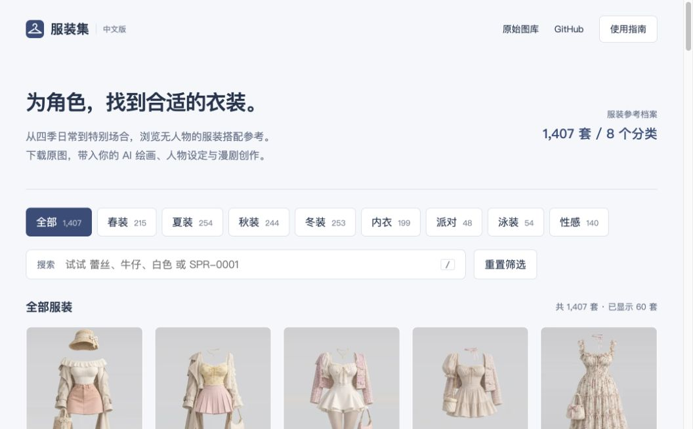

# AI Costume Gallery · 中文版服装集

面向 AI 绘画、角色设定与漫剧创作的服装参考图库。按 [Anhao 中文姿势图库](https://github.com/anhao/ai-pose-gallery-zh)的整理模式制作：保留原始数据、提供中文翻译、静态画廊与可复现的素材下载脚本。

数据来源：[衣装集 COSTUME-DB-01](https://ai-costume-gallery.pages.dev/) · 原作者：[ギア](https://x.com/giaaibusi) · 中文版维护：[Deeyu](https://github.com/Deeyu)。



<details><summary>手机预览</summary>


</details>

## 收录内容

| 分类 | 套数 |
| --- | ---: |
| 春装 | 215 |
| 夏装 | 254 |
| 秋装 | 244 |
| 冬装 | 253 |
| 内衣 | 199 |
| 派对 | 48 |
| 泳装 | 54 |
| 性感 | 140 |
| 合计 | 1,407 |

数据快照日期：2026-10-29。86 个英文关键词及 8 个分类全部附中文译文。标签来源于原站，可能不完整，不能当作完整生成提示词。图片为不含人物的服装参考，纵横比 2:3。

**完整本地镜像**：1,407 张 WebP 缩略图、1,407 张 WebP 预览图、1,407 张 PNG 原图，合计 4,221 张图片，约 1.42 GiB。画廊直接读取仓库内素材，浏览与下载不依赖原站。首次克隆体积较大；清单 `data/local-assets.json` 记录已校验的本地文件。

## 功能

- 中文分类，支持中文、英文、ID 搜索；多个词以空格分隔，按“同时包含”匹配。
- 响应式网格、缩略图懒加载、每批 60 套渐进加载。
- 大图浏览、PNG 原图下载、复制 ID；左右方向键切换、Esc 关闭、`/` 聚焦搜索。
- 无框架、无运行时依赖、无统计或遥测。
- 原始与中文 JSON、94 条对照词典、下载重试、素材校验、CI。

## 目录

```text
index.html                 中文静态画廊
assets/                    CSS、JavaScript、图标
data/costume.json          原始记录（保持原始日文字段）
data/costume-zh.json       中文分类、关键词及双语检索字段
data/meta-zh.json          分类计数
data/translations.csv      分类及关键词对照
thumbs/                    WebP 缩略图
img/                       WebP 预览图
png/                       PNG 原图
scripts/                   提取、翻译、下载、校验、构建
tests/                     数据与提取安全校验
```

## 本地预览与更新

使用 Python 3.10+，所有脚本仅依赖标准库。

```bash
python3 scripts/sync.py                      # 重新提取原站数据、生成中文数据
python3 scripts/sync.py --html /path/to/saved.html  # 也支持浏览器另存的页面
python3 scripts/download.py                  # 下载所有素材，已完成的文件自动跳过
python3 scripts/verify.py --assets           # 校验全部 4,221 张图片及数据
python3 -m http.server 8000 --bind 127.0.0.1
```

打开 <http://127.0.0.1:8000>。由于页面通过 fetch 读取 JSON，请通过 HTTP 预览。代理可通过标准 `HTTPS_PROXY` 环境变量指定；勿将凭证写入仓库。更新原站数据时如出现新关键词，先补充 `scripts/translate.py`，避免漏译。

```bash
python3 scripts/translate.py
python3 -m unittest discover -s tests -v
node --check assets/app.js
python3 scripts/build.py
```

## 部署

Cloudflare Pages 连接本仓库，框架选择 None，构建命令 `python3 scripts/build.py`，输出目录 `dist`。构建会检查全部图片及中文数据，仅拷贝网站文件，排除 Git 历史和脚本。站点内部资源使用相对路径，支持仓库子路径部署。请根据托管平台的容量限制选择部署方式。

## 版权

项目独立编写的程序代码以 MIT 开源。**图片和原始数据不适用 MIT 许可**，中文整理不代表获得图片商业使用授权。详见 [第三方声明](THIRD_PARTY_NOTICES.md)。
